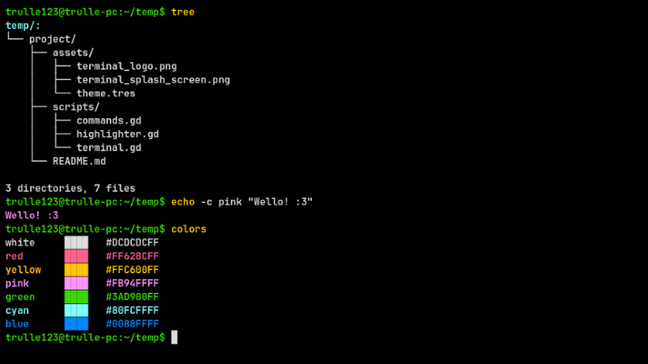

# Godot terminal

Godot terminal is a termi-

"Erm, actually it's a terminal emulator" :nerd_face::point_up:

Okay okay, Godot terminal is a terminal _emulator_ with custom shell built with GDScript. 

Note that it's in no way meant to be used as real daily drive terminal it's just a silly test mostly. 

The window is the built in Godot `CodeEdit`, with code that makes it act like a proper command line. The shell has filesystem navigation, pipelines, output redirection, syntax and output highlighting, a GDScript library system called **GDPT**, and more.



### Table of contents

- [Notable features](#notable-features)
- [Getting started](#getting-started)
- [Using libraries](#using-libraries)
- [Making libraries](#making-your-own)
- [Limitations](#what-are-the-limitations)

## Notable features

- **Unix-like command interpreter** - Run commands and executables. Chain with them `;`, pipe output with `|`, and write output to file using `>` and `>>`.
- **Custom themes** - Edit `colors.json` in the user directory to use any colors you'd like. Check [themes/](themes/) for some examples! You can also use custom font by adding it to said directory and calling it `font.ttf`. 
- **GDPT libraries** - Import command libraries from `.gd`, installed locally or from a URL. Update libraries or load them temporarily.
- **Filesystem** - Navigate through your system. Create, copy, rename, inspect and remove files.
- **Text processing** - There is `cat`, `grep`, `sort`, `wc`, `head`, `tail` and more.
- **Ease of use** - Syntax highlighting, tab completion, keyboard shortcuts and persistent command history.
- **Network** - Send HTTP requests with `curl` and get HTTP respones times with `ping`.
- **Documentation in shell** - Use `help` and `man` for short help and manual pages.

## Getting started

### Download a release

Grab the latest release from [the releases page](https://github.com/Trulle1234/Godot-terminal/releases). And then just run the exacutable!

### Run from source

```bash
git clone https://github.com/Trulle1234/Godot-terminal.git
```

And then import `project.godot` into Godot!

### What now then?

Run `help` in the terminal and get a list of all avalible commands. 

**A few things worth knowing:**

- Use `man <command>` for detailed information about a command.
- Press tab to autocomplete file and directory names.
- Use up and down arrow to navigate command history.
- Use `|` to pipe output between commands.
- Use `>` or `>>` to write or append output to a file.
- Use `;` to run multiple commands on one line.
- Run `gdpt` to install custom command libraries (see [the library guide](#using-libraries)).
- Run `colors -a` to see all available terminal colors.
- Customize the appearance with `colors.json` or add a `font.ttf` to your user data folder. Styles are loded on startup, run `reset` to apply.
- The user data folder can be referenced with `$gd_user`.
- Your command history and installed libraries are saved between sessions.

## Using libraries

| Action            | Command                    | Description                                |
| ----------------- | -------------------------- | ------------------------------------------ |
| Install locally   | `gdpt install mylib.gd`    | Install a library from a local file.       |
| Install remotely  | `gdpt -r install URL`      | Download and install a library from a URL. |
| Update            | `gdpt update mylib.gd`     | Replace an installed library.              |
| Temporary install | `gdpt -t install mylib.gd` | Load a library without saving it.          |

⚠️ Remote libraries run downloaded code. Only install libraries from trusted sources!

## Making your own

The simplest library that can be made looks something like this

```gdscript
extends RefCounted

func hello(_args, _options, _pipe_input):
    return "Hello, world"
```

### The method format

Every command must have these three parameters: `args`,  `options`, `pipe_input`. If the command does not use a paramater, prefix it with an underscore. All functions with exactly three parameters are registered as commands, unless they start with an underscoreu or are returned by a function called `get_command_blacklist()`.

```gdscript
func get_command_blacklist():
    return ["helper"]
```

To give your commands `help` descriptions add a function called `get_command_info()` that returns a dictionary.

```gdscript
func get_command_info():
    return {"hello": "Print hello world."}
```

### Return colored output

The simplest way to use color in your output is to return a two element array with a color name as stirng. Avalible color names are: `bg`, `caret`, `selection`, `selected` ,`black`, `red`, `green`, `yellow`, `blue`, `pink`, `cyan` and `white`.

```gdscript
func hello(_args, _options, _pipe_input):
    return ["Hello, world", "cyan"]
```

For multiline output with diffrent colors:
```gdscript
func hello(_args, _options, _pipe_input):
    return [
        ["Hello", "cyan"],
        ["World", "pink"]
    ]
```

### Access Terminal and TerminalCommands

A constructor can accept zero arguments, one argument (`Terminal`), or two arguments (`Terminal`, `TerminalCommands`).

```gdscript
extends RefCounted

var terminal
var terminal_commands

func _init(terminal_ref, terminal_commands_ref):
    terminal = terminal_ref
    terminal_commands = terminal_commands_ref
```

**Useful methods and properties**

| Terminal                   | TerminalCommands          |
| -------------------------- | ------------------------- |
| `set_working_dir(path)`    | `solve_path(path)`        |
| `get_home_dir()`           | `output_to_text(output)`  |
| `get_prompt()`             | `is_path_protected(path)` |
| `clear_and_reset_colors()` | `command_registry`        |
| `working_dir`              | `command_info`            |
| `entered_commands`         |
| `colors`                   |
| `highlighter`              |

## What are the limitations?
- Not Bash, Zsh, or a POSIX-compliant shell.
- Not a terminal emulator for arbitrary interactive command-line programs.
- Only a subset of Unix command options is implemented.
- Command parsing, quoting, redirection, and pipelines do not cover all real-shell edge cases.
